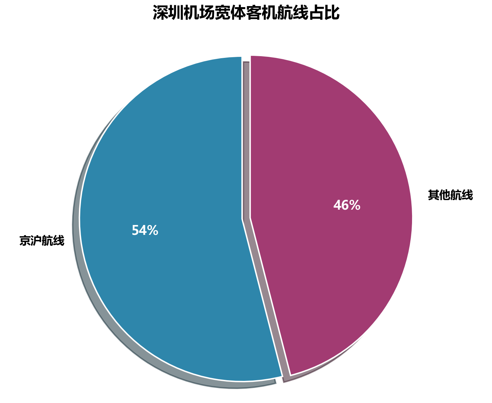
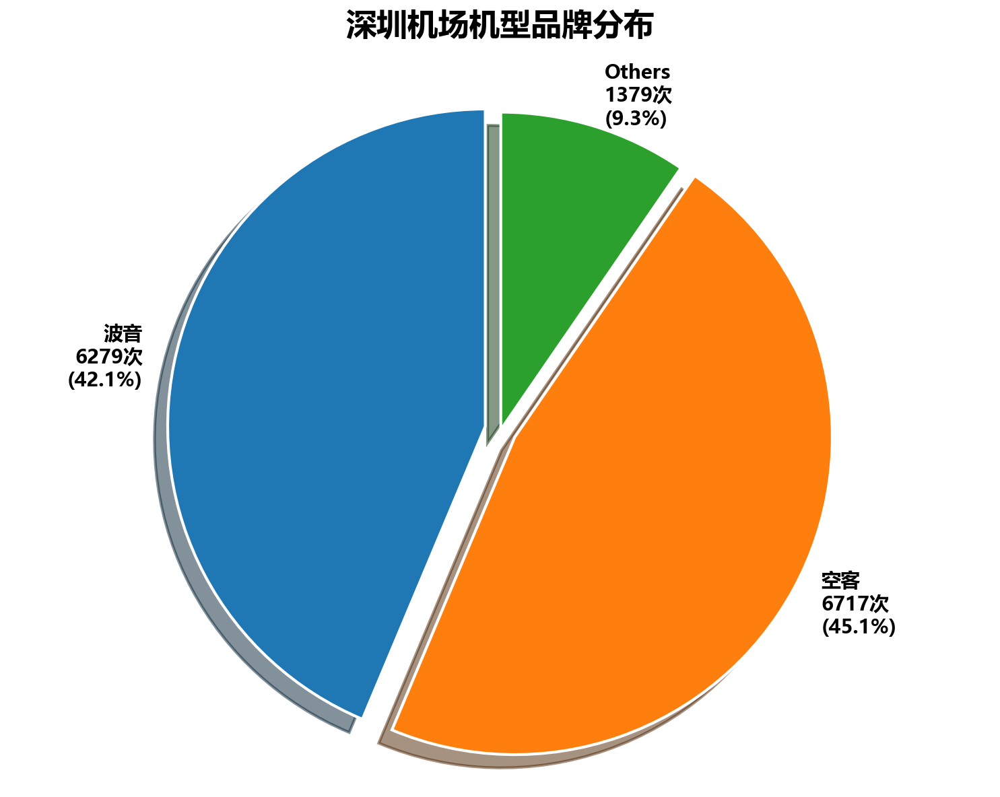

# 深圳机场出行选择研究

> 信息可视化课程结课项目 · 2025.12 · 广州美术学院湾区创新学院
> 五人小组：袁宁、卢筠言、黄若涵、潘梦飞、尹嘉慧

围绕「商务出行 vs 旅行出行」两类需求的本质差异，基于深圳机场真实数据完成数据采集、清洗、可视化与出行攻略产出。




## 研究问题

商务出行对价格不敏感、要高效抵达；旅行出行对延误和价格敏感、综合考虑时间与费用——同一座机场，两类旅客的最优选择完全不同。本研究分别从两条线给出可操作的攻略。

## 数据来源

- 旅行 APP / 航司 APP 平台数据截取（票价、起降时间、机型）
- 深圳机场年度财报、中国民航 CADAS（客流分布）
- 机场出发大屏数据（人工记录整理，见 `data/` 下 xlsx）
- 机型匹配：OpenSky aircraftDatabase.csv（91MB，不入仓库，需自行从 [OpenSky Aircraft Database](https://opensky-network.org/datasets/metadata/) 下载放于项目根目录）

## 脚本说明（`scripts/`）

| 脚本 | 作用 |
|------|------|
| `match.py` / `fix_data.py` | 将大屏数据中的注册号与 aircraftDatabase 匹配，补全机型/制造商字段 |
| `bi.py` / `bing.py` / `bint.py` | pandas + matplotlib 图表生成（客流柱状图、航线占比、机型品牌分布等） |

## 核心结论

**商务出行（时间敏感、价格不敏感）**

- 国（航）深（航）联盟、南航、东航均开展空中快线，覆盖北京/上海/重庆/成都/杭州；南航独占杭州、国航独占川渝
- 一线城市起降分布与延误数据看，国深联盟优势明显，南航紧随其后

**旅行出行（价格敏感）**

- 南航在中部地区和新疆西藏航线优势明显；深航聚焦省会航线
- OTA 平台价格普遍占优，但全服务航司定价存在「杀熟」嫌疑，同程尤为明显

## 目录结构

```text
shenzhen-airport-viz/
├── scripts/       Python 数据处理与图表脚本
├── data/          大屏数据 xlsx（按日期/航线整理）
├── charts/        成品图表
├── 结课汇报.pptx   课程结课汇报（5MB）
└── README.md
```
